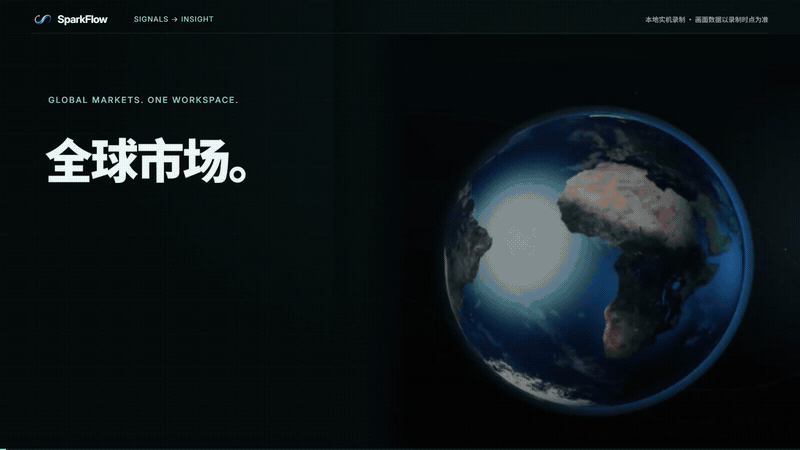
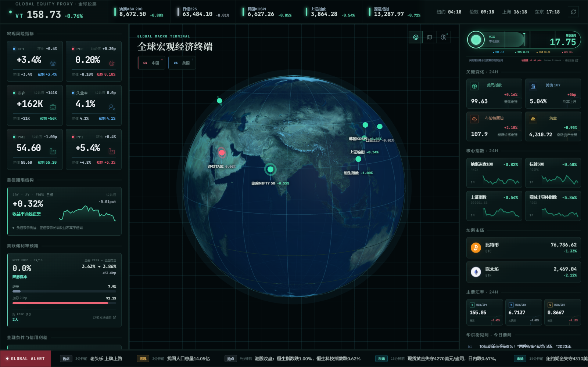
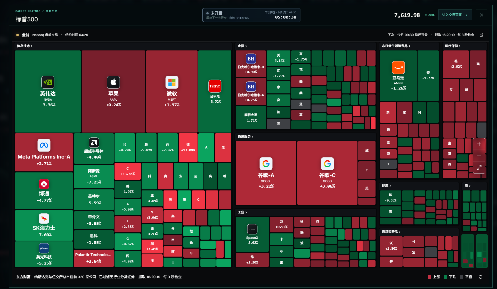
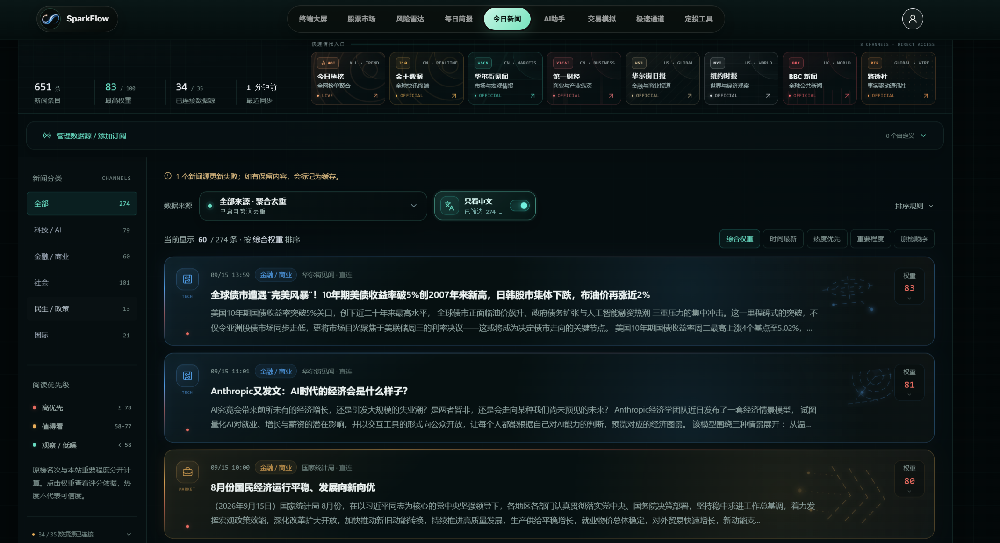
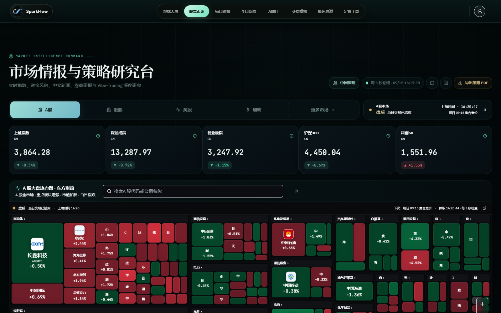
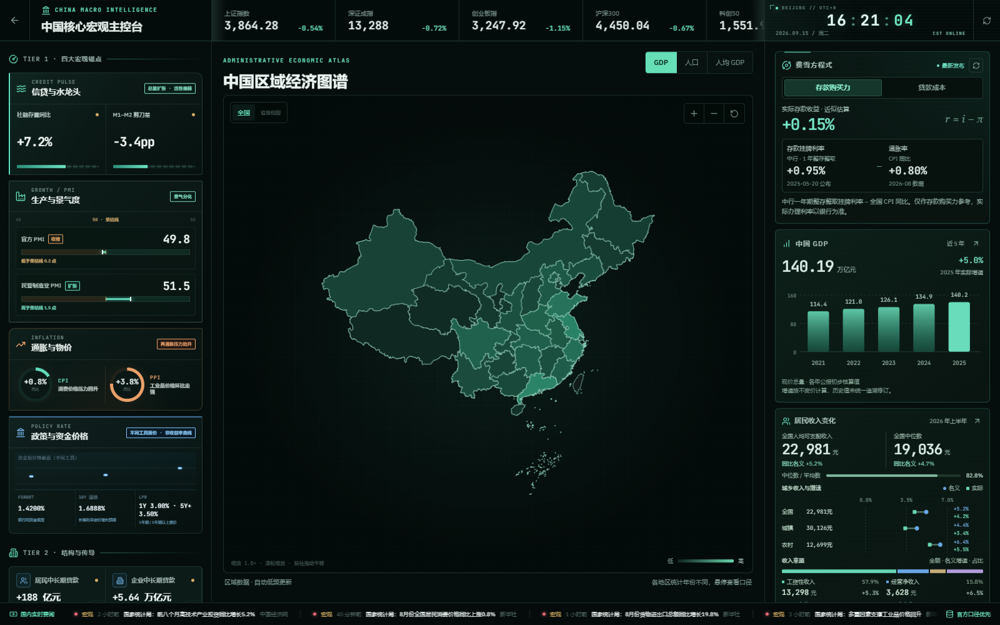
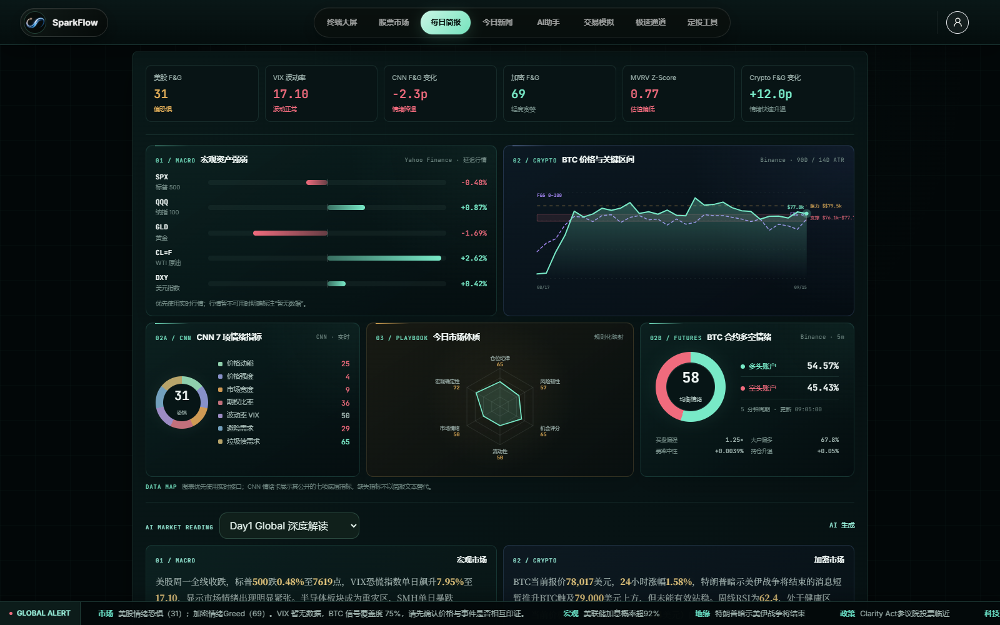
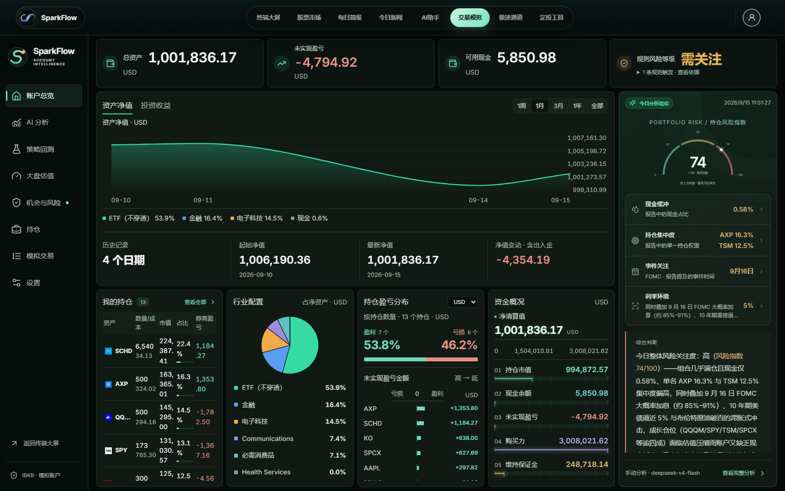
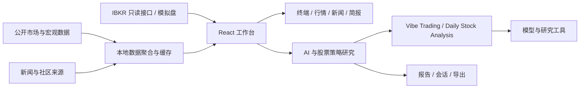

<div align="center">


# SparkFlow

### 全球市场，一处洞察。

<p>本地优先的市场情报、AI 研究与模拟交易工作台。<br />连接宏观、行情、新闻与研究，让信息有来处，让判断有依据。</p>

<p>
  <a href="./LICENSE"></a>
  
  
</p>

[观看演示](#demo) &nbsp; / &nbsp; [产品能力](#features) &nbsp; / &nbsp; [快速开始](#quick-start) &nbsp; / &nbsp; [项目文档](#documentation)

</div>

<br />

<a id="demo"></a>

<!-- sparkflow-intro:start -->
<p align="center">
  <a href="./docs/media/sparkflow-intro.mp4" title="观看 SparkFlow 完整介绍视频">
    <picture>
      <source media="(prefers-reduced-motion: reduce)" srcset="./docs/media/sparkflow-poster.webp" />
      
    </picture>
  </a>
</p>
<p align="center">
  <a href="./docs/media/sparkflow-intro.mp4"><strong>▶ 观看完整介绍视频</strong></a>
  &nbsp; · &nbsp; 44 秒 &nbsp; · &nbsp; 1080p60 &nbsp; · &nbsp; 中文解说
</p>
<p align="center">
  <sub>本地实机画面与研究流程动效 · <a href="./docs/media/sparkflow-zh.srt">中文字幕</a> · 行情与新闻以录制时点为准</sub>
</p>
<!-- sparkflow-intro:end -->

<br />

## 从市场信号，到研究线索

SparkFlow 面向个人投资者与开发者，把分散在行情网站、新闻源、研究对话和账户页面里的信息，组织进同一个工作台。你可以先观察全球市场，再核对事件来源，继续发起研究，最后保存报告、追问或进行模拟验证。

<table>
  <tr>
    <td width="50%" valign="top">
      <sub>01 / OBSERVE</sub>
      <h3>建立全局视野</h3>
      <p>从 3D 地球、宏观指标到行业热力图，在不同市场与资产之间切换观察。</p>
    </td>
    <td width="50%" valign="top">
      <sub>02 / CONNECT</sub>
      <h3>找到信息来处</h3>
      <p>聚合新闻与社区线索，按分类、时间和权重筛选，回到来源核对背景。</p>
    </td>
  </tr>
  <tr>
    <td width="50%" valign="top">
      <sub>03 / RESEARCH</sub>
      <h3>看见研究过程</h3>
      <p>查看 AI 研究进度与工具调用，保留历史会话、报告和后续追问。</p>
    </td>
    <td width="50%" valign="top">
      <sub>04 / VALIDATE</sub>
      <h3>连接模拟验证</h3>
      <p>结合策略研究、回测与 IBKR 模拟账户，审视持仓、风险和交易回执。</p>
    </td>
  </tr>
</table>

<a id="features"></a>

## 一个工作台，完整的研究路径

| 阶段 | 工作区 | 能做什么 |
| :--- | :--- | :--- |
| **观察** | 全球宏观 · 中国宏观 | 交互式地球、全球指数、利率、汇率、商品与宏观指标；中国区域经济图谱及数据来源 |
| **定位** | 多市场行情 · 热力图 | A 股、港股、美股、加密资产及多个海外市场；行业分组、搜索、缩放与交易日状态 |
| **筛选** | 今日新闻 · 每日简报 | 跨来源聚合、去重、中文筛选、自定义订阅，以及宏观资产、市场情绪和 AI 解读 |
| **研究** | AI 助手 · 股票策略 | 流式研究、工具状态、历史恢复与报告追问；股票策略研究集成 15 种策略，沿用现有模型设置 |
| **验证** | 回测 · IBKR 模拟账户 | 只读账户快照、持仓与风险分析、收益历史，以及 Paper Trading 订单和回执 |
| **积累** | 研究报告 · 长期工具 | AI 助手 PDF 导出、策略报告 Markdown 导出；指数估值、ETF 定投、星图情报与本地知识入口 |

**一条连续的工作流：** 发现信号 → 核对行情时间与事件来源 → 发起研究 → 查看过程和证据 → 保存报告、继续追问。

账户研究使用提交时的快照，并与 AI 助手共用研究链路。失败、停止、超时和恢复都有明确状态，方便分辨已取得的信息与数据缺口。

<a id="quick-start"></a>

## 在本机开始

**Windows 10 / 11 · Node.js 20+ · Python 3.11+ 或 [uv](https://docs.astral.sh/uv/)**

```powershell
git clone https://github.com/XiaoyeCodes/SparkFlow.git
cd SparkFlow
.\start-sparkflow.bat
```

首次启动会安装依赖、准备本地 Python 研究服务。完成后访问 **[localhost:5180](http://127.0.0.1:5180)**。

| 接下来 | 配置位置 |
| :--- | :--- |
| **连接 AI 模型** | 右上角头像 → 设置。支持 OpenAI、智谱、DeepSeek、通义千问及兼容 OpenAI 协议的自定义服务 |
| **开始股票策略研究** | 股票市场 → 策略研究。输入股票代码，选择策略；详见[使用说明](./docs/stock-strategy.md) |
| **连接模拟账户** | 本机启动 TWS 或 IB Gateway，并配置 Paper Trading 连接；详见[连接指南](./docs/runbooks/ibkr-paper-connect.md) |
| **停止本地服务** | 在项目目录运行 `.\stop-sparkflow.bat` |

本地优先指运行与保存方式；行情、新闻和外部模型调用仍需联网。模型调用使用你配置的服务与额度。

<details>
<summary><strong>手动启动、生产预览与可选集成</strong></summary>

手动安装并启动开发服务：

```powershell
npm ci
npm run dev -- --port 5180 --strictPort
```

`npm run dev` 会先检查每日简报、AI 研究与股票策略运行环境。生产预览可使用：

```powershell
npm run research:setup
npm run strategy:setup
npm run build
npm run preview -- --port 5180 --strictPort
```

项目还支持 Obsidian 路径、自定义 RSS / Atom 订阅及可选的 Coze 研究报告通道，配置示例见 [.env.example](./.env.example)。今日热榜入口打开 [NewsNow](https://newsnow.busiyi.world/)，无需额外启动本地热榜服务。

浏览器回归测试使用 Chrome；普通使用可通过本机浏览器访问。当前启动与服务管理流程优先支持 Windows，其他平台需手动调整脚本。

</details>

<br />

## 实机界面

以下截图来自本地运行的项目。点击图片可查看完整尺寸；行情与时间以截图时点为准。

<p>
  <a href="./docs/images/sparkflow-global-macro.png"></a>
</p>
<p align="center"><strong>全球宏观经济终端</strong><br /><sub>一张地球，连接市场、资产与宏观背景。</sub></p>

<table>
  <tr>
    <td width="50%" valign="top">
      <a href="./docs/images/sparkflow-sp500-heatmap.png"></a>
      <p><strong>多市场热力图</strong><br /><sub>从行业结构，进入具体公司。</sub></p>
    </td>
    <td width="50%" valign="top">
      <a href="./docs/images/sparkflow-today-news.png"></a>
      <p><strong>新闻情报工作台</strong><br /><sub>把聚合、筛选与来源放在一起。</sub></p>
    </td>
  </tr>
</table>

<details>
<summary><strong>更多界面：A 股市场、中国宏观、每日简报与模拟账户</strong></summary>

<br />

<table>
  <tr>
    <td width="50%" valign="top">
      <a href="./docs/images/sparkflow-market-heatmap.png"></a>
      <p><strong>A 股市场</strong><br /><sub>市场观察与行业结构。</sub></p>
    </td>
    <td width="50%" valign="top">
      <a href="./docs/images/sparkflow-china-macro.png"></a>
      <p><strong>中国宏观</strong><br /><sub>宏观指标与区域经济图谱。</sub></p>
    </td>
  </tr>
  <tr>
    <td width="50%" valign="top">
      <a href="./docs/images/sparkflow-daily-brief.png"></a>
      <p><strong>每日简报</strong><br /><sub>跨资产信号与市场解读。</sub></p>
    </td>
    <td width="50%" valign="top">
      <a href="./docs/images/sparkflow-paper-account.png"></a>
      <p><strong>IBKR 模拟账户</strong><br /><sub>Paper Trading · 账户、持仓与风险。</sub></p>
    </td>
  </tr>
</table>

</details>

## 为可回看的研究而设计

**数据有时间，也有口径。** 公共资源独立加载，使用分级缓存、后台刷新和失败退避；行情、财务与宏观信息尽量保留观察时间、来源和口径，旧数据有明确提示。

**过程留下记录。** 研究会话与单次执行分别保存，流式显示进度和工具调用。报告内追问沿用会话；不确定是否成功的提交不会自动重试，减少重复任务和模型消耗。

**个人配置在本地管理。** 密钥、研究记录、账户快照和上传文件默认位于 Git 忽略目录。账户研究以只读信息为主，交易功能使用 Paper Trading；研究工具不获得提交真实订单的权限。

<details>
<summary><strong>查看系统结构</strong></summary>



账户信息、AI 配置与个人订阅绕过公共缓存。Markdown 经过安全渲染，模型返回的 HTML 和脚本不会直接执行。更具体的数据与研究边界见[公共缓存设计](./docs/public-data-cache.md)和[账户研究数据说明](./docs/account-research-data.md)。

</details>

<a id="documentation"></a>

## 文档导航

| 使用与配置 | 设计与实现 |
| :--- | :--- |
| [股票策略研究](./docs/stock-strategy.md) | [公共数据缓存与后台刷新](./docs/public-data-cache.md) |
| [IBKR 账户工作台](./docs/runbooks/ibkr-account-workbench.md) | [新闻来源、排序与容错](./docs/news-sources-and-ranking.md) |
| [Paper Trading 连接](./docs/runbooks/ibkr-paper-connect.md) | [账户研究与 AI 助手共用报告](./docs/account-assistant-research.md) |
| [每日市场简报配置](./docs/daily-briefing-setup.md) | [账户研究数据来源与边界](./docs/account-research-data.md) |
| [地球页金十财经早餐](./docs/daily-digests.md) | [架构决策记录](./docs/adr/) |
| [估值监控工具](./docs/runbooks/market-valuation-monitor.md) | [研究引擎与动态专家团队](./docs/guides/sparkflow-agent-engineering-tutorial.md) |

## 开发与贡献

欢迎通过 [Issue](https://github.com/XiaoyeCodes/SparkFlow/issues) 反馈问题、数据口径或改进建议，也欢迎提交 Pull Request。

<details>
<summary><strong>技术栈与目录结构</strong></summary>

| 层级 | 技术 |
| :--- | :--- |
| 前端 | React 18 · TypeScript · React Router · Tailwind CSS · Framer Motion |
| 可视化 | Three.js · OGL · D3 · Lightweight Charts · GSAP |
| 本地 API | Vite Plugin Server · Node.js · Zod · Undici |
| AI 研究 | Python 3.11 · FastAPI · LangChain · LangGraph · Vibe Trading · Daily Stock Analysis |
| 文档与导出 | React Markdown · jsPDF · html2canvas · ReportLab |
| 质量保障 | TypeScript Build · Node 验证脚本 · Pytest · Playwright |

```text
SparkFlow/
├─ src/                  页面、组件、图表与研究交互
├─ server/               行情、新闻、缓存、账户与研究 API
├─ services/
│  ├─ daily-stock-analysis/  股票策略研究引擎
│  └─ vibe-trading/          AI 研究服务
├─ scripts/              启动、同步、诊断与验证
├─ tests/                Node / Python / Playwright 测试
├─ public/               品牌、地球纹理与公开资源
└─ docs/                 使用指南、设计记录与演示素材
```

</details>

<details>
<summary><strong>构建与回归验证</strong></summary>

```powershell
npm run build
```

按改动范围选择对应回归：

```powershell
npm run test:public-cache
npm run test:page-cache
npm run test:stock-strategy
npm run test:ibkr:unit
npm run test:ibkr:e2e
```

其他定向检查见 [package.json](./package.json)。浏览器测试使用合成账户和受控接口，不会连接真实账户、发送真实订单或自动生成付费报告。提交前请确认变更不包含本地密钥、账户快照、日志或研究记录。

</details>

## 使用边界

公开数据源可能延迟、限流、变更或暂时不可用；财务数据受币种、财年、ADR 与供应商口径影响。新闻权重不等同于事实核验，AI 报告也可能遗漏引用或产生错误，重要结论应回到原始来源核对。

部分海外数据源需要可访问对应服务的网络环境。在中国大陆使用时，请检查 Yahoo Finance、美国劳工统计局、Coinbase 等数据源的连通性。公开部署前，请根据使用地区核对行情、新闻与第三方数据的授权条款。

> **风险提示**：投资有风险，入市需谨慎。本项目 AI 生成的内容仅供参考，数据可能延迟或出错，请自行核对。投资者应独立判断、审慎决策，并自行承担投资损失；项目作者不对相关投资结果负责。

## 开源与致谢

根项目采用 [MIT License](./LICENSE)。集成的研究引擎保留独立版权、许可证与修改说明：

- [HKUDS / Vibe-Trading](https://github.com/HKUDS/Vibe-Trading)：参见 [LICENSE](./services/vibe-trading/LICENSE) 与 [NOTICE](./services/vibe-trading/NOTICE)。
- [ZhuLinsen / daily_stock_analysis](https://github.com/ZhuLinsen/daily_stock_analysis)：参见 [LICENSE](./services/daily-stock-analysis/LICENSE)、[NOTICE](./services/daily-stock-analysis/NOTICE) 与 [第三方声明](./services/daily-stock-analysis/THIRD_PARTY_NOTICES.md)。

<details>
<summary><strong>Star History</strong></summary>

<a href="https://www.star-history.com/?repos=XiaoyeCodes%2FSparkFlow&amp;type=date&amp;legend=bottom-right">
  <picture>
    <source media="(prefers-color-scheme: dark)" srcset="https://api.star-history.com/chart?repos=XiaoyeCodes/SparkFlow&amp;type=date&amp;theme=dark&amp;legend=bottom-right" />
    <source media="(prefers-color-scheme: light)" srcset="https://api.star-history.com/chart?repos=XiaoyeCodes/SparkFlow&amp;type=date&amp;legend=bottom-right" />
    
  </picture>
</a>

</details>

<br />

<div align="center">
  <strong>SparkFlow</strong><br />
  <sub>Observe clearly. Research with context. Keep thinking.</sub><br /><br />
  <a href="#demo">回到演示 ↑</a>
</div>
