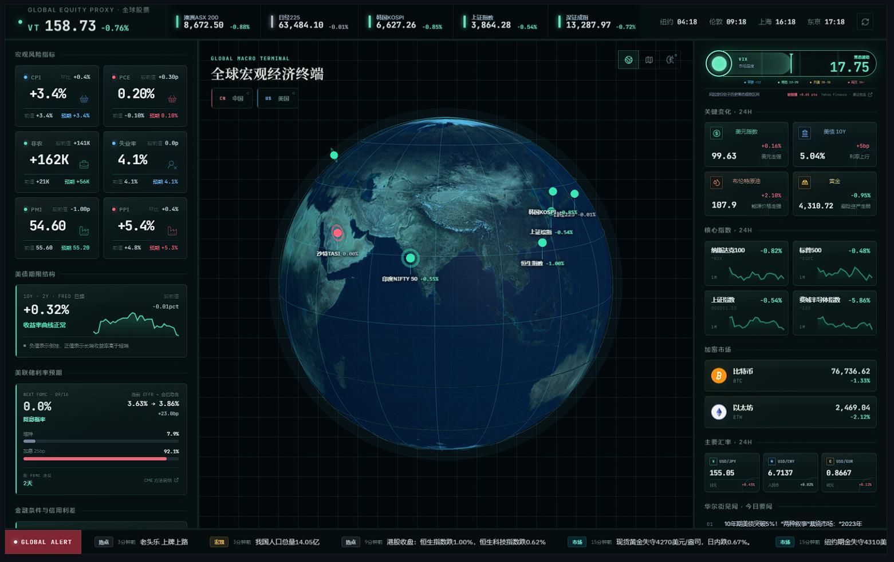
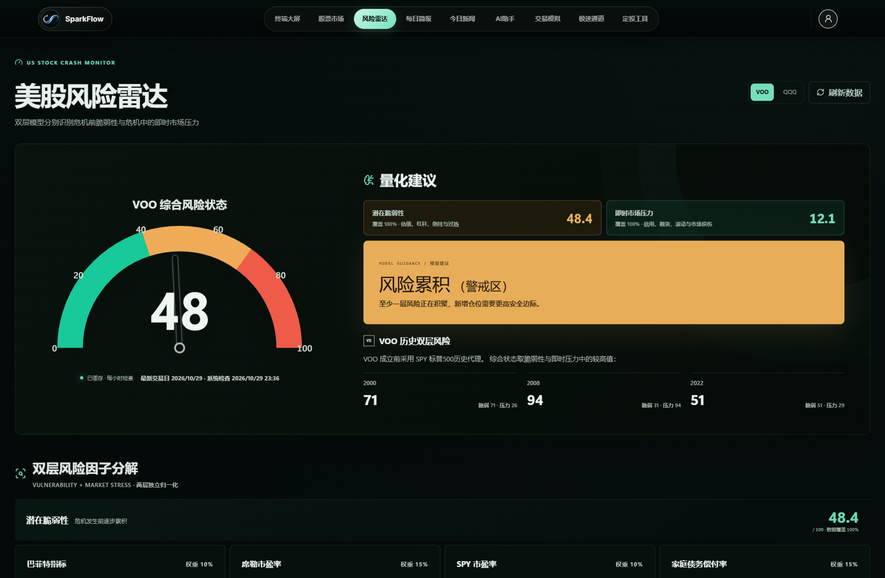
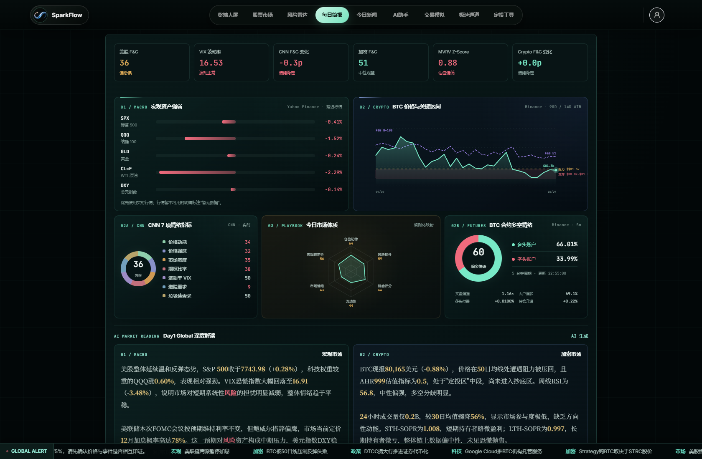
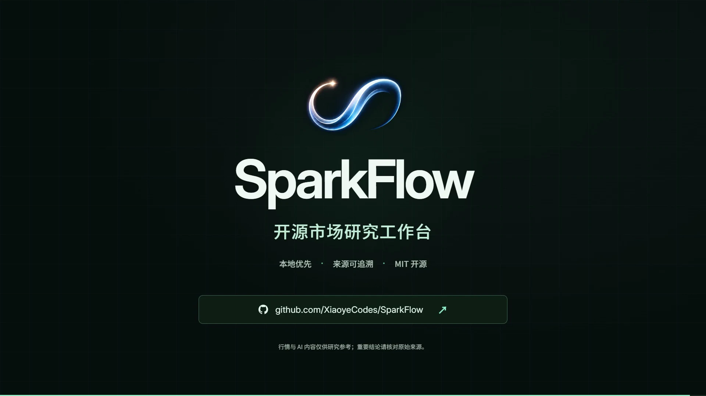
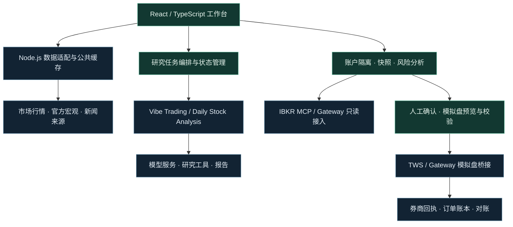

<a id="top"></a>

<p align="center">
  
</p>

<div align="center">

**本地优先的全球市场情报、风险分析与 AI 投研工作台**

从宏观全景到持仓细节，把观察、研究、回测与模拟验证连接起来。

[](./LICENSE) [](./package.json) [](./package.json) [](./services/vibe-trading/pyproject.toml)

[产品全景](#features) · [特色功能](#highlights) · [视频演示](#demo) · [系统架构](#architecture) · [数据来源](#data-sources) · [快速开始](#quick-start)

</div>

## 一个工作台，连接全球市场

SparkFlow 为个人投资者与开发者提供一套本地研究环境：用地球终端建立全球视野，用风险雷达理解市场压力，用简报与新闻核对背景，再把问题交给 AI 研究、策略回测和模拟账户继续验证。数据保留来源与时间，研究保留过程与报告，订单保留确认与回执。

[](./docs/images/sparkflow-global-terminal.png)
<p align="center"><sub>全球宏观经济终端 · 用户提供的实机截图 · 行情与时间均以截图时点为准</sub></p>

<a id="features"></a>

## 产品全景

| 工作区与源码 | 核心能力 |
| :--- | :--- |
| **[宏观终端](./src/routes/Market.tsx)** | 3D 地球、全球权益指数、通胀与就业、利率曲线、商品、外汇与加密行情；中国宏观与区域经济图谱 |
| **[多市场行情](./server/sinaHeatmap.ts)** | A 股、港股、美股与海外市场，行业热力图、公司标识、搜索缩放、交易日历与来源切换 |
| **[风险雷达](./src/routes/RiskRadar.tsx)** | VOO / QQQ 双层风险评分，因子贡献、自定义权重、SMA200 与长期历史风险重建 |
| **[每日简报](./src/routes/DailyBrief.tsx)** | 宏观资产强弱、市场情绪、BTC 与衍生品指标、新闻和 AI 解读；按小时更新与历史快照 |
| **[新闻情报](./src/routes/Signals.tsx)** | 国际媒体、财经新闻、社区热榜与 AI 日报；排序解释、中文筛选、URL 去重、自定义 RSS / Atom |
| **[AI 助手](./src/routes/Assistant.tsx)** | 流式研究、工具执行过程、历史会话、报告追问、PDF 导出；与账户研究共用研究链路 |
| **[股票策略](./src/routes/StockStrategy.tsx)** | 集成 15 种策略，个股综合分析、策略问答、历史恢复和 Markdown 导出 |
| **[模拟交易](./src/routes/IbkrAccount.tsx)** | IBKR 账户净值、持仓、现金与风险，Paper Trading 人工订单、券商回执与对账 |
| **[策略回测](./src/components/ibkr/BacktestWorkspace.tsx)** | 结构化策略、历史数据集、费用与滑点、权益曲线、最大回撤、结果包和运行哈希 |
| **[估值](./server/ibkrValuation.ts)与[定投](./src/routes/Trader.tsx)** | 指数估值、盈利收益率与国债对比；ETF 定投、全天候配置与再平衡工具 |
| **[知识](./src/routes/Starmap.tsx)与[工具](./src/routes/HyperspeedRoute.tsx)** | 星图情报、极速通道、阅读与知识入口，以及可选 Obsidian 集成 |

<a id="highlights"></a>

## 特色功能

### 01 / 风险雷达：让风险有结构，也有出处

[](./docs/images/sparkflow-risk-radar.png)

风险拆成两层独立观察：**潜在脆弱性**关注估值、杠杆、收益率曲线和趋势过热；**即时市场压力**关注信用利差、金融条件、VIX、回撤与恐慌。综合状态取两层较高值，并展示因子贡献与数据覆盖，方便追问“风险为什么变高”。

- **可解释**：每个因子带来源、观测时间、权重和贡献；权重可调整，两层分别归一化。
- **可对照**：VOO / QQQ 与 SMA200、历史事件及近 30 年可得数据的月度风险走势联动。
- **有缺失处理**：单层有效权重不足 65% 时暂不评分；历史代理、缺失估值与情绪代理有明确口径。

历史曲线属于同一规则下的风险重建与对照，不代表预测准确率或策略收益回测。实现见 [风险模型](./src/routes/RiskRadar.tsx)与[历史序列](./server/riskRadarTimeline.ts)。

### 02 / 每日简报：从数据面板，进入市场叙事

[](./docs/images/sparkflow-daily-brief-current.png)

把宏观资产、市场情绪、加密市场、重要事件和 AI 解读汇成一份可阅读的简报。公开快照与模型摘要按版次关联，读者能够看到使用的数据、来源和生成时点。

- **跨资产视角**：股票、美元、美债、黄金、原油与 BTC 放在同一阅读场景中。
- **背景与信号结合**：情绪、衍生品及可得链上指标，配合新闻、事件和 Day1 Global 深度解读。
- **后台更新**：北京时间整点更新，恢复最近成功快照；失败保留原时间，缓存 AI 摘要供多个访问者复用。

每日市场简报与账户简报分别服务于“市场环境”和“当前组合”，调度与数据边界独立。详见[简报配置](./docs/daily-briefing-setup.md)。

### 03 / 模拟交易：把研究结论放进可核对的账户环境

[](./docs/images/sparkflow-paper-account.png)
<p align="center"><sub>IBKR Paper Trading 模拟账户展示 · 净值变化与投资收益分别呈现</sub></p>

账户工作台把净值、现金、持仓、行业配置、风险提示和 AI 分析放在一起。官方 MCP 用于只读账户接入；TWS / IB Gateway 桥接用于账户同步和受限的人工模拟盘订单。

- **账户分析**：保留券商币种与盈亏口径，显示风险证据；账户研究冻结提交时的快照。
- **人工模拟下单**：合约核对 → 订单预览 → 明确确认 → 提交 → 回执 / 对账；未决订单保留资金或份额预占。
- **状态可区分**：提交中、券商确认、成交、撤单和状态未知分别处理，避免重复发送与错误展示。
- **回测可复核**：策略、数据、配置与运行各自留存哈希；展示费用、滑点、权益曲线和最大回撤，支持结果包导出。

AI 研究与订单执行分开，实盘账户接入保持只读。见[账户工作台](./docs/runbooks/ibkr-account-workbench.md)与[订单故障隔离 ADR](./docs/adr/0007-isolate-paper-order-failures.md)。

### 04 / AI 研究与策略：从一次问答，到持续积累

**AI 助手**展示研究进度、工具调用、报告与历史会话；账户页发起的研究也进入同一链路，报告内可以继续追问。**股票策略研究**集成 Daily Stock Analysis 的 15 种策略，复用现有模型配置，提供个股报告与策略问答。

研究按任务运行，页面刷新或离开后可恢复查看；取消、超时、失败和部分完成有独立状态。结果不确定的提交不会自动重发，降低重复任务和模型消耗。AI 助手支持 PDF 导出，股票策略报告支持 Markdown 导出。

实现入口：[研究适配](./server/ibkrAssistantResearch.ts) · [股票策略桥接](./server/stockStrategy.ts) · [账户研究设计](./docs/account-assistant-research.md)。

### 05 / 行情与情报：保留市场结构，也保留信息来处

<table>
  <tr>
    <td width="50%" valign="top"><a href="./docs/images/sparkflow-sp500-heatmap.png"></a><p><strong>多市场热力图</strong><br /><sub>从行业结构进入公司与资产。</sub></p></td>
    <td width="50%" valign="top"><a href="./docs/images/sparkflow-today-news.png"></a><p><strong>新闻情报工作台</strong><br /><sub>按来源、时间、热度与重要程度筛选。</sub></p></td>
  </tr>
</table>

国际股票市场通过配置与适配器扩展；加密行情组合实时流与 REST 快照。新闻保留原始标题、来源、时间及排序依据，支持添加公开 RSS / Atom 订阅。中国宏观覆盖官方指标、区域经济与地方政策线索；ETF 定投和全天候工具承接长期配置场景。

<details>
<summary><strong>查看中国宏观与 A 股界面</strong></summary>


</details>

<a id="demo"></a>

## 44 秒产品演示

<!-- sparkflow-intro:start -->
<p align="center">
  <a href="./docs/media/sparkflow-intro.mp4" title="观看 SparkFlow 完整介绍视频">
    <picture>
      <source media="(prefers-reduced-motion: reduce)" srcset="./docs/media/sparkflow-poster.webp" />
      <source type="image/webp" srcset="./docs/media/sparkflow-preview-hd.webp" />
      
    </picture>
  </a>
</p>
<p align="center">
  <a href="./docs/media/sparkflow-intro.mp4"><strong>▶ 观看完整介绍视频</strong></a>
  &nbsp; · &nbsp; 44 秒 &nbsp; · &nbsp; 1080p60 &nbsp; · &nbsp; 中文解说
</p>
<p align="center">
  <sub>上方为 8 秒无声预览 · 完整影片含中文解说与<a href="./docs/media/sparkflow-zh.srt">字幕</a> · 行情与新闻以录制时点为准</sub>
</p>
<!-- sparkflow-intro:end -->

<a id="architecture"></a>

## 系统架构

SparkFlow 采用 **React + TypeScript 界面、Node.js 本地 API 与 Python 研究服务**的分层结构。Vite 同时承载开发 / 预览服务中的 API 中间件；公共数据缓存、研究任务与账户桥接按职责分离。



**运行边界：** 页面、API 和后台调度组成完整本地应用。只发布静态 `dist` 无法运行数据聚合、研究任务或账户桥接。当前主要面向单用户本地环境；公网部署需要另外设计身份认证、访问隔离、服务运维与数据授权。

### 关键工程设计

| 工程问题 | 当前实现 | 可以深入阅读的代码与文档 |
| :--- | :--- | :--- |
| 多来源数据慢、失败和时间口径不一致 | 按资源独立加载，保留来源 / 观察时间，备用源与有界旧快照；较旧响应不覆盖较新行情 | [公共数据缓存](./docs/public-data-cache.md) · [宏观发布处理](./server/usMacroRelease.ts) |
| 多页面重复请求与首屏等待 | 同资源请求合并、分级有效期、启动预热、后台刷新、失败退避及磁盘恢复 | [publicDataCache](./server/publicDataCache.ts) · [pagePreloadCache](./server/pagePreloadCache.ts) |
| AI 任务跨页面与长时间运行 | 会话与单次执行分开，流式进度、任务恢复、取消与超时；不重试结果不确定的写请求 | [研究链路设计](./docs/account-assistant-research.md) |
| 交易回调重复或乱序 | 人工确认、持久化幂等、订单局部故障隔离、未决预占与券商证据对账 | [订单故障隔离](./docs/adr/0007-isolate-paper-order-failures.md) |
| 报告难以验证或重复实验 | 研究保留来源与截止时间；回测保存策略 / 数据 / 配置 / 运行哈希 | [回测工作区](./src/components/ibkr/BacktestWorkspace.tsx) |
| 本地配置与公共数据混用 | 私有配置 / 账户快照绕过公共缓存；RSS 限制公网地址、响应大小和重定向；Markdown 安全渲染 | [订阅抓取](./server/newsSubscriptions.ts) · [用户数据](./server/userData.ts) |

更完整的服务边界、研究时序、数据源映射、源码导航和验证方式见 **[工程说明](./docs/engineering-overview.md)**。

### 技术栈与代码组织

| 层次 | 技术 | 项目中的职责 |
| :--- | :--- | :--- |
| 应用语言 | TypeScript · Python · CSS · GLSL | 类型化界面 / API、研究与数据处理、视觉样式与 WebGL 着色 |
| 前端 | React 18 · React Router 6 · Vite 6 | 页面路由、状态与组件组合、开发和构建 |
| 界面与动效 | Tailwind CSS 3 · Framer Motion · GSAP · Lucide | 终端界面、页面过渡与交互动效 |
| 数据可视化 | Three.js · OGL · D3 · Lightweight Charts | 地球与星图、行业热力图、行情和历史曲线 |
| Node.js API | Vite 插件 / 中间件 · Undici · Zod | 来源适配、缓存、请求校验、任务与桥接接口 |
| AI 与研究 | Python 3.11+ · FastAPI · LangChain · LangGraph · LiteLLM | 集成研究引擎、模型调用、工具执行与策略问答 |
| 持久化 | JSON / 本地文件 · SQLite | 公共快照、个人配置、研究会话、任务与回测记录 |
| 文档与导出 | React Markdown · remark-gfm · jsPDF · html2canvas · ReportLab | 报告阅读、Markdown 与 PDF 导出 |
| 质量保障 | TypeScript · Node 测试脚本 · Pytest · Playwright | 类型检查、数据规则、接口与浏览器回归 |

版本以 [package.json](./package.json)、[Vibe Trading 依赖](./services/vibe-trading/pyproject.toml)及[股票研究依赖](./services/daily-stock-analysis/requirements.txt)为准。

```text
SparkFlow/
├─ src/
│  ├─ routes/               终端、风险雷达、简报、研究与账户页面
│  ├─ components/           地球、热力图、图表、回测与交易组件
│  ├─ lib/                  类型、客户端、缓存规则与导出
│  └─ data/                 导航、市场日历与区域配置
├─ server/                  Node.js 数据适配、缓存、调度与账户 API
├─ services/
│  ├─ vibe-trading/         集成的 AI 研究引擎与 IBKR 本地服务
│  └─ daily-stock-analysis/ 集成的股票策略研究引擎
├─ scripts/                 环境准备、数据验证、回归与素材生成
├─ tests/                   Node / Python / Playwright 验证
├─ public/                  品牌、地球纹理、公开资源与定投工具
├─ docs/                    使用说明、架构决策、工程文档与演示
└─ vite.config.ts           前端构建与本地服务集成
```

<a id="data-sources"></a>

## 数据来源与可信度

| 数据域 | 项目接入的主要来源 | 展示与处理原则 |
| :--- | :--- | :--- |
| 股票、指数、外汇与商品 | 新浪财经、腾讯财经、东方财富、Yahoo Finance | 按市场和资源选择主备源；保留币种、交易时段、来源时间与延迟状态 |
| 美国宏观与利率 | BLS、BEA、美联储 / FRED、美国财政部、纽约联储 | 区分统计期、发布日期和抓取时间；保留同比 / 环比等口径 |
| 中国宏观与区域数据 | 国家统计局、人民银行、财政部、政府与地方公开发布 | 官方指标优先，区域与全国口径分开，保留原始来源 |
| 估值与风险因子 | FRED、Multpl / Shiller、World PE Ratio、FactSet、CNN | 估值口径与历史代理分别标注；缺失数据留空，不补造评分输入 |
| 加密市场 | Binance、OKX、CoinGecko、CoinPaprika；财经早餐另接 Coinbase 等来源 | 区分交易所报价、市值与衍生品统计；实时流配合 REST 快照 |
| 新闻、社区与 AI 日报 | RSS / Atom、国际媒体、Readhub、微博、V2EX、Hacker News、GitHub Trending、Hugging Face、AIbase | 保留原始链接与排名，规则排序可解释，失败有状态 |
| 账户与交易 | IBKR 官方 MCP、TWS / IB Gateway | 账户净值、现金、持仓与成交采用券商口径；外部参考行情独立展示 |

接入不代表商业数据再分发授权。公开源可能延迟、限流或调整结构；轮询频率不等于交易所级实时行情。来源级实现与备用路径见[数据源工程映射](./docs/engineering-overview.md#data-map)。

<a id="quick-start"></a>

## 在本机开始

**Windows 10 / 11 · 推荐 Node.js 22.18+ · Python 3.11+ 或 [uv](https://docs.astral.sh/uv/)**

```powershell
git clone https://github.com/XiaoyeCodes/SparkFlow.git
cd SparkFlow
.\start-sparkflow.bat
```

首次启动会安装依赖、准备本地 Python 研究服务。完成后访问 **[localhost:5180](http://127.0.0.1:5180)**。

| 接下来 | 配置位置 |
| :--- | :--- |
| **连接 AI 模型** | 右上角头像 → 设置。支持 OpenAI、智谱、DeepSeek、通义千问及兼容 OpenAI 协议的自定义服务 |
| **开始股票策略研究** | 股票市场 → 策略研究。输入股票代码，选择策略；详见[使用说明](./docs/stock-strategy.md) |
| **连接模拟账户** | 本机启动 TWS 或 IB Gateway，并配置 Paper Trading 连接；详见[连接指南](./docs/runbooks/ibkr-account-workbench.md) |
| **停止本地服务** | 在项目目录运行 `.\stop-sparkflow.bat` |

本地优先指运行与保存方式；行情、新闻和外部模型调用仍需联网。模型调用使用你配置的服务与额度。

<details>
<summary><strong>手动启动、生产预览与可选集成</strong></summary>

手动安装并启动开发服务：

```powershell
npm ci
npm run dev -- --port 5180 --strictPort
```

`npm run dev` 会先检查每日简报、AI 研究与股票策略运行环境。生产预览可使用：

```powershell
npm run research:setup
npm run strategy:setup
npm run build
npm run preview -- --port 5180 --strictPort
```

项目还支持 Obsidian 路径、自定义 RSS / Atom 订阅及可选的 Coze 研究报告通道，配置示例见 [.env.example](./.env.example)。今日热榜入口打开 [NewsNow](https://newsnow.busiyi.world/)，无需额外启动本地热榜服务。

浏览器回归测试使用 Chrome；普通使用可通过本机浏览器访问。当前启动与服务管理流程优先支持 Windows，其他平台需手动调整脚本。

</details>


<a id="verification"></a>

## 构建与验证

```powershell
npm run build
```

| 验证范围 | 入口 |
| :--- | :--- |
| 公共缓存、请求合并与加载策略 | `npm run test:public-cache` · `npm run test:page-cache` |
| 宏观与实时行情口径 | `npm run test:macro-release` · `npm run test:realtime-quotes` |
| 简报与股票策略 | `npm run test:daily-brief` · `npm run test:stock-strategy` |
| 账户、回执与订单状态 | `npm run test:ibkr:unit` |
| 页面交互与跨模块回归 | `npm run test:ibkr:e2e` |

浏览器回归使用 Chrome；测试用例覆盖合成账户与受控接口。自动测试通过与真实券商成交、模型报告质量属于不同验证层级。完整命令见 [package.json](./package.json)，测试组织见[工程说明](./docs/engineering-overview.md#validation)。

<a id="documentation"></a>

## 文档导航

| 使用与配置 | 工程与设计 |
| :--- | :--- |
| [股票策略研究](./docs/stock-strategy.md) | **[系统工程说明](./docs/engineering-overview.md)** |
| [IBKR 账户与模拟盘工作台](./docs/runbooks/ibkr-account-workbench.md) | [公共数据缓存与后台刷新](./docs/public-data-cache.md) |
| [每日市场简报配置](./docs/daily-briefing-setup.md) | [新闻来源、排序与容错](./docs/news-sources-and-ranking.md) |
| [金十财经早餐](./docs/daily-digests.md) | [账户研究与 AI 助手共用链路](./docs/account-assistant-research.md) |
| [估值监控工具](./docs/runbooks/market-valuation-monitor.md) | [账户研究数据来源与边界](./docs/account-research-data.md) |
| [研究引擎与专家团队设计](./docs/guides/sparkflow-agent-engineering-tutorial.md) | [架构决策记录 ADR](./docs/adr/) |

欢迎通过 [Issue](https://github.com/XiaoyeCodes/SparkFlow/issues) 反馈问题、数据口径或建议，也欢迎提交 Pull Request。提交前请确认变更不包含本地密钥、账户快照、日志或研究记录。

## 使用边界

项目以个人本地研究为主要场景。公开数据、财务口径和 AI 输出均需要核验；新闻权重不等同于事实核验。历史风险重建、规则评分与策略回测用于辅助分析，不承诺预测能力或未来收益。部分海外数据源需要可访问对应服务的网络环境。

> **风险提示**：投资有风险，入市需谨慎。本项目 AI 生成的内容仅供参考，数据可能延迟或出错，请自行核对。投资者应独立判断、审慎决策，并自行承担投资损失；项目作者不对相关投资结果负责。

## 开源与致谢

根项目采用 [MIT License](./LICENSE)。集成的研究引擎保留独立版权、许可证与修改说明：

- [HKUDS / Vibe-Trading](https://github.com/HKUDS/Vibe-Trading)：参见 [LICENSE](./services/vibe-trading/LICENSE) 与 [NOTICE](./services/vibe-trading/NOTICE)。
- [ZhuLinsen / daily_stock_analysis](https://github.com/ZhuLinsen/daily_stock_analysis)：参见 [LICENSE](./services/daily-stock-analysis/LICENSE)、[NOTICE](./services/daily-stock-analysis/NOTICE) 与 [第三方声明](./services/daily-stock-analysis/THIRD_PARTY_NOTICES.md)。

<details>
<summary><strong>Star History</strong></summary>

<a href="https://www.star-history.com/?repos=XiaoyeCodes%2FSparkFlow&amp;type=date&amp;legend=bottom-right">
  <picture>
    <source media="(prefers-color-scheme: dark)" srcset="https://api.star-history.com/chart?repos=XiaoyeCodes/SparkFlow&amp;type=date&amp;theme=dark&amp;legend=bottom-right" />
    <source media="(prefers-color-scheme: light)" srcset="https://api.star-history.com/chart?repos=XiaoyeCodes/SparkFlow&amp;type=date&amp;legend=bottom-right" />
    
  </picture>
</a>

</details>

<br />

<div align="center">
  <strong>SparkFlow</strong><br />
  <sub>Observe clearly. Research with context. Keep thinking.</sub><br /><br />
  <a href="#demo">回到演示 ↑</a>
</div>
