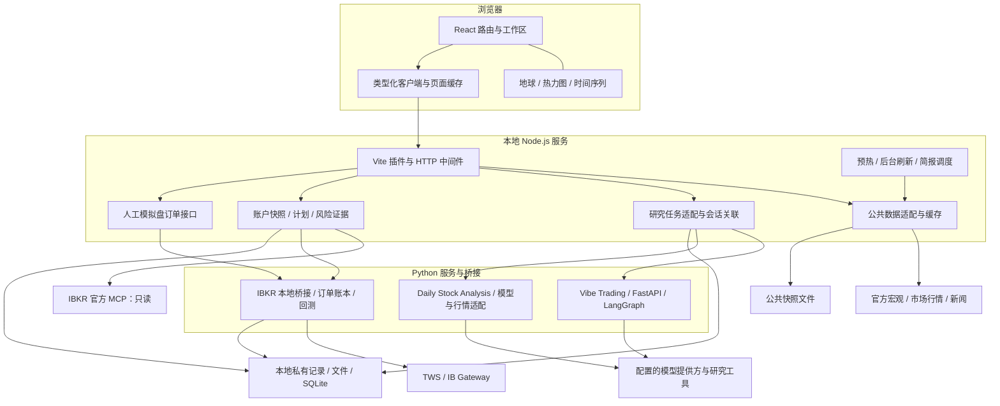
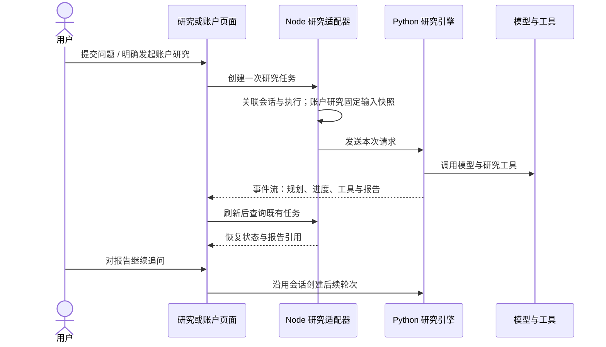

# SparkFlow 工程说明

本文描述当前仓库中的运行结构、数据链路、研究与账户边界。源码与配置是最终依据；方案文档中的未来设计不视为已交付功能。

## 1. 系统定位与实现范围

SparkFlow 是以本地单用户为主要场景的市场情报与研究工作台。核心语言是 TypeScript 与 Python，界面使用 React；Three.js / OGL 承担 WebGL 视觉，D3 与 Lightweight Charts 承担市场结构和时间序列展示。

项目工程分为三个部分：

| 部分 | 责任 | 代表入口 |
| :--- | :--- | :--- |
| SparkFlow 应用层 | 页面与交互、市场适配、缓存与调度、风险雷达、研究入口、账户工作台及导出 | [src](../src/) · [server](../server/) · [vite.config.ts](../vite.config.ts) |
| 集成与适配层 | 连接研究引擎、复用模型配置、转换任务与事件协议、账户研究快照、订单与回测接口 | [ibkrAssistantResearch](../server/ibkrAssistantResearch.ts) · [stockStrategy](../server/stockStrategy.ts) · [ibkrWorkbench](../server/ibkrWorkbench.ts) |
| 上游引擎与基础能力 | Vibe Trading 的研究与工具能力；Daily Stock Analysis 的个股分析与策略能力 | [Vibe Trading NOTICE](../services/vibe-trading/NOTICE) · [Daily Stock Analysis NOTICE](../services/daily-stock-analysis/NOTICE) |

集成依赖的能力应与 SparkFlow 的界面、服务编排和适配工作分别说明。上游版权和修改说明随源码保留。

## 2. 运行拓扑

Node.js 本地 API 并非独立部署的通用后端：当前通过 Vite 开发 / 预览服务接入。后台调度需要进程持续运行；浏览器关闭后可继续执行，电脑休眠或进程停止后暂停。只有静态 `dist` 的部署不具备这些能力。

### 存储边界

| 数据 | 存储方式 | 处理原则 |
| :--- | :--- | :--- |
| 公共行情与简报快照 | 内存 + 本地快照文件 | 按资源有效期复用；保留源时间，过期与失败显式呈现 |
| 模型配置与个人设置 | `UserData/` 下本地配置 | Git 忽略；策略桥接通过 stdin 传递配置，避免写进进程参数 |
| 账户状态与研究记录 | `.sparkflow/`、引擎会话 / 运行目录等 | 按账户或会话隔离，不进入公共缓存 |
| 订单、策略和回测 | Python 模块使用的本地 SQLite 与归档 | 记录状态、执行证据与哈希，用于恢复和对账 |

详见 [.gitignore](../.gitignore)、[用户数据管理](../server/userData.ts)与[账户工作台文档](./runbooks/ibkr-account-workbench.md)。本地优先不表示离线运行：外部模型和行情请求仍会访问相应服务。

## 3. 三条关键链路

### 3.1 公共数据：页面快照与后台刷新

1. 客户端按资源读取快照，页面优先使用仍有效的数据。
2. 服务端合并同资源的并发请求；不同宏观卡片和行情资源独立加载。
3. 来源适配器执行超时、备用源与口径校验，记录来源时间及状态。
4. 后台刷新成功后替换缓存；失败进入退避，并在硬期限内保留最后成功快照。
5. 重启恢复有效磁盘快照；较旧的行情响应不能覆盖较新的报价。

高频报价和低频宏观指标采用不同策略；页面可见性控制高频轮询，实时流静默时可回退 HTTP。刷新目标周期不构成上游行情更新保证。

代码：[公共缓存](../server/publicDataCache.ts)、[HTTP 层](../server/publicDataHttp.ts)、[缓存策略](../src/lib/publicDataPolicy.ts)、[页面预加载](../server/pagePreloadCache.ts)。设计：[公共数据缓存](./public-data-cache.md)、[独立加载 ADR](./adr/0001-independent-global-market-data-loading.md)。

### 3.2 研究：提交一次，持续跟踪

研究请求的结果不确定时，不通过自动重发 POST 来恢复；只重试状态读取。取消和超时绑定到具体执行，避免取消后续轮次。报告安全渲染，原始模型 HTML / 脚本不直接执行。账户研究和独立 AI 助手共用研究链路；股票策略研究通过独立桥接复用同一模型配置。

代码：[账户研究适配](../server/ibkrAssistantResearch.ts)、[股票策略适配](../server/stockStrategy.ts)、[Assistant](../src/routes/Assistant.tsx)。设计：[账户与助手共用研究](./account-assistant-research.md)、[策略研究](./stock-strategy.md)。

### 3.3 模拟交易：明确确认、状态隔离与对账

模拟盘需要当前账户身份、模式和有效券商上下文。接口通过 Zod 校验预览与确认数据，确认关联预览 ID 和请求体哈希。重复、乱序回调与普通订单拒绝在订单层处理；未决订单保留最坏情况下的资金或份额预占。矛盾的持久证据才升级为账户完整性问题。

研究工具没有实盘下单权限；账户只读接入、人工模拟盘订单与策略回测属于不同边界。软件测试不等于已经在券商完成真实成交验证。

代码：[账户与订单接口](../server/ibkrWorkbench.ts)、[Python 模拟订单流程](../services/vibe-trading/agent/src/ibkr_terminal/paper_flow.py)。设计：[订单故障隔离 ADR](./adr/0007-isolate-paper-order-failures.md)。历史的旧终端运行手册仅供溯源，当前行为以现行代码与账户工作台文档为准。

## 4. 风险模型与回测口径

风险雷达采用双层结构，覆盖 VOO / QQQ：

- **潜在脆弱性**：市场市值 / GDP、CAPE、标的估值、家庭债务偿付、收益率曲线、趋势过热与贪婪情绪。
- **即时压力**：Baa 信用利差、NFCI、VIX、实际波动、回撤、下行趋势、恐慌与倒挂后陡峭化。
- **聚合规则**：各层以可用权重归一化，综合状态取两层较高值；单层有效权重低于 65% 时不输出该层得分。
- **历史口径**：按可得历史数据重建月度分数，区分实际值和代理值；VOO 成立前使用标普 500 代理，部分历史情绪与估值具有替代口径。

风险重建用于解释与历史对照，不视为前瞻预测评估。策略回测另外使用结构化策略和数据集，保留费用、滑点、权益曲线、最大回撤与运行哈希；回测结果不能自动授权交易。

代码：[风险雷达](../src/routes/RiskRadar.tsx)、[历史序列](../server/riskRadarTimeline.ts)、[回测工作区](../src/components/ibkr/BacktestWorkspace.tsx)、[回测引擎](../services/vibe-trading/agent/src/ibkr_terminal/backtests.py)。

## 5. 数据源工程映射

此表列出当前仓库的来源适配与使用位置；具体主备顺序因市场、数据类型和接口可用性而异。

| 数据域 | 主要来源 | 代码与说明 |
| :--- | :--- | :--- |
| 全球权益与市场热力图 | 新浪、腾讯、东方财富、Yahoo Finance | [行情入口](../vite.config.ts)、[新浪热力图](../server/sinaHeatmap.ts)、[全球权益报价](../server/globalEquityQuote.ts) |
| 核心指数与汇率 | 新浪共享批次，Yahoo 备用及历史曲线 | [核心指数](../server/macroCoreIndexQuotes.ts)、[币种方向与报价](../server/macroCurrencyQuotes.ts) |
| 美国通胀、就业与增长 | BLS、BEA、美联储 / FRED | [宏观发布](../server/usMacroRelease.ts)、[官方备用序列](../server/usMacroFallbacks.ts)、[CPI 备用](../server/usCpiFallback.ts) |
| 利率与金融条件 | 纽约联储、美国财政部 / FRED、Chicago Fed | [有效联邦基金利率](../server/effectiveFedRate.ts)、[金融条件](../server/financialConditions.ts) |
| 中国宏观与区域经济 | 国家统计局、人民银行、财政部、政府和区域官方发布 | [官方来源](../server/chinaOfficialSources.ts)、[区域经济](../server/chinaRegionalEconomy.ts)、[区域新闻](../server/chinaRegionalFeed.ts) |
| 估值与市场风险 | World PE Ratio、FactSet、Multpl / Shiller、CNN、FRED；历史序列含 NDX 估值来源 | [估值数据](../server/ibkrValuationData.ts)、[风险时间线](../server/riskRadarTimeline.ts) |
| 加密现货与市场名单 | Binance、OKX、CoinGecko、CoinPaprika | [市场名单解析](../server/cryptoMarketUniverse.ts)、[接入与合并](../vite.config.ts) |
| 每日简报 | 行情与宏观来源、CNN 情绪、加密与衍生品接口、Day1 Global 等内容 | [简报服务](../server/dailyBriefService.ts)、[版次缓存](../server/dailyBriefAiSummaryCache.ts)、[部署与调度](./daily-briefing-setup.md) |
| 新闻与订阅 | 国际媒体 RSS、Readhub、微博、V2EX、HN、GitHub、HF、AIbase 等 | [聚合与解析](../server/newsFeed.ts)、[订阅验证](../server/newsSubscriptions.ts)、[来源与排序说明](./news-sources-and-ranking.md) |
| IBKR 账户 | 官方 MCP、TWS / IB Gateway | [MCP 适配](../server/ibkrMcp.ts)、[Gateway 桥接](../server/ibkrGatewayBridge.ts)、[账户数据边界](./account-research-data.md) |
| 个股研究 | 引擎的 AkShare、efinance、Tushare、yfinance 等适配器，及 SparkFlow 的补充行情与财报适配 | [策略集成说明](./stock-strategy.md)、[上游依赖](../services/daily-stock-analysis/requirements.txt) |

### 统一质量原则

1. **时间分开**：行情成交 / 报价时间、宏观统计期、发布日期、抓取时间和报告生成时间不能互相替代。
2. **单位分开**：币种、百分比 / 百分点、同比 / 环比、名义 / 实际、指数代理与 ETF 本体分别说明。
3. **来源分开**：主备来源不静默拼接成无法解释的数据；参考报价不覆盖券商资产和盈亏口径。
4. **缺失显式**：超时、权限不足和缺字段不视为零；旧快照保留原时间，过期后降级。
5. **权限独立**：数据接口可访问不等于允许商业再分发，公开部署需要另行确认授权与使用条款。

## 6. 验证策略

| 层级 | 关注点 | 入口示例 |
| :--- | :--- | :--- |
| 静态构建 | 类型、模块与打包 | `npm run build` |
| 数据与缓存规则 | 字段解析、时间 / 币种口径、主备源、并发合并、硬过期和退避 | `npm run test:public-cache`、`npm run test:macro-release`、`npm run test:realtime-quotes` |
| 研究与简报 | 任务状态、输入边界、摘要版次、恢复与失败 | `npm run test:stock-strategy`、`npm run test:daily-brief`；[workbench 测试](../tests/workbench/) |
| 账户与交易 | 账户身份、回执、资源预占、重复与乱序、故障隔离 | `npm run test:ibkr:unit`；[Python IBKR 测试](../services/vibe-trading/agent/tests/ibkr_terminal/) |
| 浏览器 | 页面操作、报告阅读、风险雷达、简报与模拟盘界面 | `npm run test:ibkr:e2e`；[Playwright 用例](../tests/ibkr/) |

具体环境要求与范围以 [package.json](../package.json)、[Playwright 配置](../playwright.ibkr.config.ts)和对应脚本为准。开发与测试推荐 Node.js 22.18+；部分验证脚本使用 Node 内置的 [TypeScript 类型剥离](https://nodejs.org/docs/latest-v22.x/api/typescript.html#type-stripping)。定向测试使用合成数据或受控接口；真实来源可用性、券商集成和模型质量需要分别验证。

## 7. 可扩展点与当前取舍

- **来源扩展**：在来源适配层添加解析器与数据质量规则，而非在页面中直接堆叠抓取逻辑。
- **市场扩展**：复用市场配置、交易日历和热力图结构，参见[国际市场配置 ADR](./adr/0004-config-driven-international-equity-markets.md)。
- **模型扩展**：通过现有提供方与兼容接口接入，明确各引擎支持的模型与工具能力。
- **服务拆分**：当前 Vite 集中承载本地服务有利于一键运行；进一步服务化时，需要迁移调度、生命周期、鉴权与部署边界。
- **多人托管**：当前并未宣称提供多租户隔离、生产 SLA 或交易所级行情保证。多人部署需要补充身份体系、审计、监控、持久化运维和数据许可。

## 8. 展示素材

README 地球封面直接渲染项目的 [EarthScene](../src/components/EarthScene.tsx)，排版源位于 [hero.html](./design/readme/hero.html)。终端主图使用用户提供的原始截图；风险雷达与简报截图来自本机运行页面。图片中的时间、行情、净值和状态均只代表截图时点，模拟账户截图不构成收益证明。

视频说明及可复现预览生成命令见 [演示素材](./media/README.md)。页面布局参考了 [Supabase README](https://github.com/supabase/supabase#readme)的能力与架构组织、[LobeHub README](https://github.com/lobehub/lobehub#readme)的品牌开篇与功能展示方式；视觉素材、文案与工程说明使用本项目内容。
